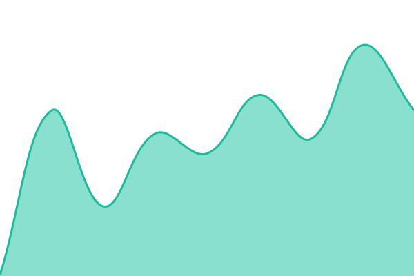
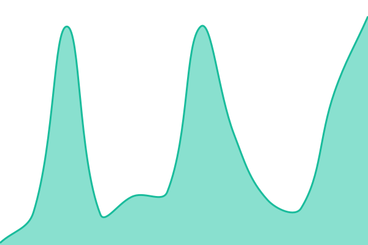
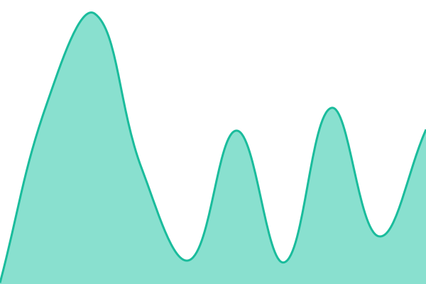
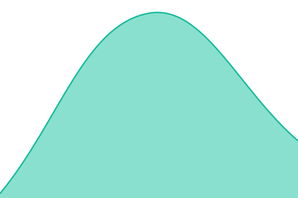

## About this project

A personal learning project to practice production-support workflows:

- **Detection:** GitHub Actions checks each endpoint every 5 minutes
- **Incident tickets:** an outage automatically opens a GitHub Issue, assigned to me, and closes it on recovery
- **Communication:** a public status page shows current status and history
- **Trend analysis:** response time and uptime history help spot degradation before a full outage

Public endpoints are included as a control group to distinguish a site issue from a monitoring-side issue.

> Personal learning project. No employer data or systems are involved.

# [📈 Live Status](https://ruogit.github.io/status): <!--live status--> **🟧 Partial outage**

This repository contains the open-source uptime monitor and status page for [ruogit](https://ruogit.github.io/status), powered by [Upptime](https://github.com/upptime/upptime).

With [Upptime](https://upptime.js.org), you can get your own unlimited and free uptime monitor and status page, powered entirely by a GitHub repository. We use [Issues](https://github.com/ruogit/status/issues) as incident reports, [Actions](https://github.com/ruogit/status/actions) as uptime monitors, and [Pages](https://ruogit.github.io/status) for the status page.

<!--start: status pages-->
<!-- This summary is generated by Upptime (https://github.com/upptime/upptime) -->
<!-- Do not edit this manually, your changes will be overwritten -->
<!-- prettier-ignore -->
| URL | Status | History | Response Time | Uptime |
| --- | ------ | ------- | ------------- | ------ |
|  [Personal Website](https://ruogit.github.io) | 🟩 Up | [personal-website.yml](https://github.com/ruogit/status/commits/HEAD/history/personal-website.yml) | 

 114ms
     
 | 

<a href="https://ruogit.github.io/status/history/personal-website">100.00%</a>
    

|  [GitHub API](https://api.github.com) | 🟩 Up | [git-hub-api.yml](https://github.com/ruogit/status/commits/HEAD/history/git-hub-api.yml) | 

 74ms
     
 | 

<a href="https://ruogit.github.io/status/history/git-hub-api">100.00%</a>
    

|  [Wikipedia](https://www.wikipedia.org) | 🟩 Up | [wikipedia.yml](https://github.com/ruogit/status/commits/HEAD/history/wikipedia.yml) | 

 131ms
     
 | 

<a href="https://ruogit.github.io/status/history/wikipedia">100.00%</a>
    

|  [Simulated Checkout Service](https://ruogit.github.io/simulated-outage) | 🟥 Down | [simulated-checkout-service.yml](https://github.com/ruogit/status/commits/HEAD/history/simulated-checkout-service.yml) | 

 42ms
     
 | 

<a href="https://ruogit.github.io/status/history/simulated-checkout-service">51.45%</a>
    

<!--end: status pages-->

[**Visit our status website →**](https://ruogit.github.io/status)

## 📄 License

- Powered by: [Upptime](https://github.com/upptime/upptime)
- Code: [MIT](./LICENSE) © [Anand Chowdhary](https://anandchowdhary.com)
- Data in the `./history` directory: [Open Database License](https://opendatacommons.org/licenses/odbl/1-0/)
